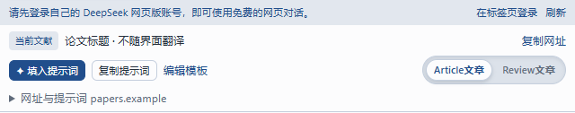

# XPaper-Read · 文献精读（火狐插件）

在 Firefox 侧栏中使用 DeepSeek 阅读论文：将当前论文信息与自定义模板组合成结构化提示词，也可通过自己的 API 提取和总结网页、PDF。

[XPaper-Read - 火狐插件商店链接！](https://addons.mozilla.org/zh-CN/firefox/addon/xpaper-read/ "前往火狐插件商店 XPaper-Read 主页！")

**版本 1.0.8 · Firefox 桌面版 142+**

## 主要功能

- **DeepSeek 网页侧栏**：登录自己的账号，将论文标题、网址和模板填入聊天框，核对后自行发送。
- **API 精读**：支持网页、PDF、选中文字和本地导入；需自行配置 API Key 并承担调用费用。
- **两套阅读模板**：Article 梳理研究问题、设计、方法与结果；Review 梳理主题、证据、共识与分歧。均可自定义，并要求生成 Mermaid / Graphviz 图源码。
- **笔记与外观**：保存最近 30 条阅读记录，导出 Markdown；支持中英文、明暗主题和六种配色。

## 安装

1. 在 Firefox 打开 `about:debugging#/runtime/this-firefox`。
2. 点击 **临时载入附加组件…**，选择 `XPaper-Read-1.0.8.xpi`，或源码构建后的 `dist/manifest.json`。
3. 点击扩展图标，或按 **Alt + Shift + Y** 打开侧栏。

当前 XPI 尚未签名，临时加载在浏览器重启后失效。永久安装与商店提交见 [提交说明](docs/AMO-SUBMISSION.md)。

## 开始阅读

**网页版**：打开论文 → 在侧栏登录 DeepSeek → 点击顶部胶囊切换 **Article文章**（默认）或 **Review文章** → 点击填入提示词 → 检查提示词并发送。网址无法获取全文时，可在 DeepSeek 中上传 PDF。

**API 精读**：在 **设置 → API 定义** 配置接口和密钥 → 读取论文 → 核对材料 → 按模板精读。

在 **设置 → 模板定义** 分别编辑 Article 和 Review 模板。网页版与 API 精读共用文章类型胶囊，点击控件任意位置都会切换类型，默认 Article；对应模板由用户选择。DeepSeek 页面使用全部可用宽度；API 精读、笔记和设置内容居中，占可用宽度的 90%。模型输出需结合原文核对。

<details>
<summary>查看界面预览</summary>



截图使用合成测试材料。

</details>

## 开发与打包

需要 Node.js 22.13+。在源码目录执行：

```text
npm ci
npm test
npm run package
```

构建结果位于 `dist/`；XPI 和源码 ZIP 位于 `artifacts/`。上传 GitHub 时，将 `source/` 内的全部内容作为仓库根目录。

## 更多说明

- [使用指南](docs/USAGE.md)：登录、网页与 PDF 读取、模板和笔记、完整验证命令。
- [归档与恢复开发](docs/ARCHIVE.md)
- [隐私与数据处理](docs/PRIVACY.md)
- [验证记录与已知边界](docs/VALIDATION.md)
- [Firefox 商店提交](docs/AMO-SUBMISSION.md)

作者：**Xi Zhang** · [oca-john@hotmail.com](mailto:oca-john@hotmail.com)
