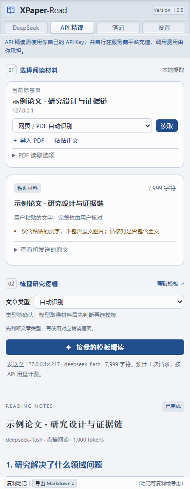
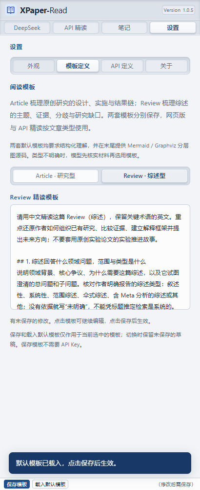

# XPaper-Read · 火狐文献精读

在 Firefox 原生侧栏中直接打开 **DeepSeek 网页聊天**，一边看论文，一边用自己的模板提问。工具栏集成论文网址复制、结构化提示词填入、模板编辑和笔记导出；另有可选的 **自定义 API 精读**。提供分别自定义的 Article（研究型）与 Review（综述型）精读模板。Article 默认框架采用本项目用户指定的五个问题：

1. 研究解决了什么领域问题？
2. 创新设计或巧思是什么？
3. 怎么逐步实施的？
4. 有什么核心结果逐个推进了逻辑链条？
5. 为什么能发表到该期刊（贡献）？

这是一版可本地试用的桌面 Firefox 扩展，最低版本 **142**。没有服务器部署步骤。本目录是完整项目源码，可继续编辑、重新打包，也可直接作为 GitHub 仓库根目录。归档结构与恢复开发步骤见 [归档说明](docs/ARCHIVE.md)。

## 先安装试用

使用归档附带的 `XPaper-Read-1.0.5.xpi` 可临时加载，不需要安装 Node.js。若从源码运行，先按下文执行 `npm ci` 和 `npm run build`，生成 `dist/`。

**1.0.5 更新**：在 **设置 → 模板定义** 中分别编辑 Article 和 Review 模板。读取时自动初判文章类型，并允许手动纠正；线索不足时，在同一次模型请求中先核实材料与类型，再使用对应模板。Review 模板覆盖综述范围、组织方法、主题证据、共识分歧、研究缺口与贡献，末尾要求知识结构总览和分主题证据图。

设置页继续居中占可用侧栏宽度的 **90%**；固定页脚为 **25 px**，沿用凹凸导航、中英文、跟随浏览器明暗主题和六种主体配色。**设置 → 关于** 显示作者 **Xi Zhang** 与联系邮箱 **<oca-john@hotmail.com>**。

版本显示为 **Version 1.0.5**，安装包为 `XPaper-Read-1.0.5.xpi`（尚未签名或发布）。重新打包后位于 `artifacts/`；配套源码和审核说明见 [商店提交说明](docs/AMO-SUBMISSION.md)。

界面排版更新：笔记标题去掉编号；设置页所有标题与字段标题采用“外观与语言”的字号和主题色，不使用编号；语言与明暗主题分别使用两列、三列等宽居中按钮。插件自身文字统一增加 **1 pt**，页脚仍为 **25 px**。

1. 在 Firefox 地址栏输入 `about:debugging#/runtime/this-firefox`。
2. 点击 **“临时载入附加组件…”**。
3. 选择 **`XPaper-Read-1.0.5.xpi`**，或源码构建后的 **`dist/manifest.json`**。
4. 点击工具栏的 XPaper-Read 图标，或按 **Alt + Shift + Y** 打开侧栏。
5. 如果侧栏在左边：右键 Firefox 的侧栏按钮 → **自定义侧栏** → **将侧栏移至右侧**。旧版侧栏可在标题菜单中选择“移动到右侧”。侧栏的位置是 Firefox 的全局设置，扩展不能替你强制修改。
6. 默认进入 **DeepSeek** 网页侧栏，不需要 API Key。在同一个 Firefox 配置中正常登录 DeepSeek；如果侧栏未同步，点击 **在标签页登录**，完成后回到论文标签页，点击侧栏 **刷新**。

**临时加载会在 Firefox 重启后失效，需要再次加载。** `XPaper-Read-1.0.5.xpi` 是未签名包，不能当作正式签名插件在普通发行版中永久安装。希望每天使用而不重新加载时，需要先完成 Mozilla 签名，具体步骤见下文。

从已加载的 `dist/` 升级时，在 `about:debugging#/runtime/this-firefox` 找到 XPaper-Read，点击 **重新载入**，然后关闭并重新打开侧栏。在 **设置 → 关于** 中可以查看版本 **1.0.5**。

## 网页侧栏：日常使用

1. 在主窗口打开论文网页或公开的 PDF 链接。右侧保留 DeepSeek 网页聊天。
2. 点击 **填入阅读提示**。插件将当前标题、网址和已保存的五项模板写入聊天框；不会覆盖已有草稿。
3. 在 DeepSeek 页面检查 **联网搜索** 等选项，再点击网页自己的 **发送** 按钮。回答直接在侧栏出现；可继续追问、上传 PDF、使用 DeepSeek 原有功能。
4. 要保存本机笔记，选中回答文字，点击 **保存选中回答**，核对内容和来源后保存。也可以使用网页的复制回答功能，再点 **粘贴回答**；这种方式更适合保留 Markdown 表格。

**网址与提示词**可展开核对和修改。**复制网址**仅复制论文链接，**复制提示词**复制完整结构化提示。切换“设置”“笔记”“API 精读”等栏目不会主动重载已打开的聊天页面。

版本号左侧的 **收起顶部** 会折叠品牌、导航、登录提示和网址工具，保留 DeepSeek 会话及底部笔记按钮；点击 **展开顶部** 恢复。按钮折叠后仍与右边缘留出距离，为网页的新建对话入口留出空间。切换过程中聊天不会重新载入。

四个栏目的底栏统一为 **25 px**，固定在窗口底部，右侧括号文字是提示。DeepSeek 底栏提供 **保存选中回答 / 粘贴回答**；API 精读提供 **复制笔记 / 导出 Markdown**；笔记提供 **清空阅读记录**（仍需确认）；设置底栏随子标签显示 **恢复默认外观**、**保存模板 / 载入默认模板** 或 **保存 API 设置 / 测试连接**。

拖动 Firefox 的侧栏边缘即可调整宽度。聊天页面占满工具栏和笔记栏之间的剩余高度；API 精读和笔记使用整个可用宽度，仅保留少量内部边距。设置页内容居中，最大宽度为可用侧栏宽度的 90%。较矮窗口展开提示词或笔记编辑框时，侧栏内容可滚动。

### 外观与语言

进入 **设置 → 外观**（Settings → Appearance），可选择 **简体中文 / English**、**跟随浏览器主题 / 浅色 / 深色** 和六种主体配色。默认跟随 Firefox 向扩展侧栏提供的明暗偏好，浏览器主题改变时自动切换，无需重新加载会话；也可固定浅色或深色。所有选择即时生效并自动保存在本机，重新打开侧栏后保留；“恢复默认外观”恢复中文、跟随浏览器、蓝色。已有手动选择会保留，可点击“跟随浏览器主题”切换。设置子标签顺序为 **外观 → 模板定义 → API 定义 → 关于**。

语言和明暗选项均为等宽按钮，选中项凸起；可用鼠标、方向键或 Home / End 切换。窄侧栏中的较长文字会居中换行，保持同组按钮等高。

配色影响页面底色、文字、高亮、按钮及 Logo。Firefox 工具栏按钮与原生侧栏入口图标也会同步换色；所有书本图标均为浅主题色底、深主题色线条。浅色和深色均支持六种配色，页眉与底栏保持紧凑尺寸。

语言切换覆盖插件菜单、设置、提示、状态、错误及动态材料信息。不会改写你的模板、文献标题、原文或已保存的回答，也不会重新载入网页会话或清空未提交的输入。总结的语言仍由阅读模板决定。**DeepSeek 网页的语言和主题由网站自身设置控制**，插件仅修改外围界面。

### 登录与可用性

- 侧栏内嵌真实 `https://chat.deepseek.com/` 网页，网页登录由 DeepSeek 处理；没有自建登录表单，没有读取 Cookie、登录令牌或调用私有聊天接口。
- Firefox 扩展页面中的 iframe 通常使用未分区存储；同一普通浏览器配置的登录有条件复用。容器标签页、隐私窗口、额外的 Cookie 隔离设置可能使用不同的登录环境，此时需在侧栏单独登录。未在用户自己的已登录配置中验证。
- 如果出现空白、需要验证或登录未同步，先使用 **在标签页登录** 正常打开 DeepSeek，完成网站自己的步骤后再刷新侧栏。插件不自动处理验证码。
- 网页版操作不调用付费模型 API，也不消耗 API Key 额度；网页版的使用频率、服务可用性、模型和功能由 DeepSeek 决定，不能承诺“永远无限额”。
- 输入框适配依赖网页当前结构。页面更新时可能需要调整；复制提示词始终可作为备用操作。输入框尚未就绪时，填入按钮保持禁用；连接失败和操作受阻以临时提示显示，不占用常驻状态栏。

### 链接不等于全文

提示词要求先核实实际阅读范围；打不开原文时要求模型停止精读并提示上传文件。仅有摘要时，回答必须说明范围，不能虚构全文结果。

公开网页或 PDF 链接可以交给网页版尝试读取；校园登录、付费墙、本地 `file:`、`blob:` 和一次性下载链接不保证可读。本地 PDF 可直接通过 **DeepSeek 聊天框自己的附件按钮**上传，或使用 API 精读中的文件导入。

网址保留 `id` 等论文定位参数，去除片段、常见追踪和登录/签名参数；签名链接可能因此失效，应换成 DOI 或文章永久链接。展开提示词可核对实际填入的内容。

## 可选 API Key 与模型

在 [DeepSeek 开放平台](https://platform.deepseek.com/api_keys) 创建自己的 API Key；在插件设置中输入，**不需要将密钥发到聊天里或写进源码**。

- **测试连接**只请求 `/models`，检查密钥与模型列表，不发送文章，不产生生成请求。
- 使用 DeepSeek API 按其开放平台用量计费。能够登录网页版聊天，不等于 API 已开通或有余额。
- 默认模型名称根据 **2026-10-20 查询到的官方文档**设置为 `deepseek-flash`，支持文字与图片。模型名称可以手动修改，或在测试连接后从列表中选择。
- 深度思考默认关闭。开启时建议将最大输出 token 调整到 16,384 或 32,768；思考本身也会占用额度。
- 支持兼容 Chat Completions 的其他 HTTPS API；本机开发接口允许 `http://localhost:端口` 或 `http://127.0.0.1:端口`。输入基础地址即可，例如 `https://provider.example/v1`。
- 更换 API 服务商时，应填写相应服务商的密钥。密钥只发送到设置中的 API 地址，API 请求拒绝重定向。

网页侧栏和 API 是两个独立入口：前者直接使用网站，后者在插件中调用官方兼容接口。查阅的 DeepSeek 公开文档没有提供可直接接入第三方扩展的网页版登录 OAuth 流程；此版本无需使用该流程。

## API 精读：自动提取与总结

先进入 **设置 → API 定义** 保存 Key 和 API 地址，再切换到 **API 精读**。默认模型为 `deepseek-flash`，也支持自定义兼容接口。该栏目顶部提示需要自己的 API Key，并自行充值承担调用费用；DeepSeek 栏目顶部则提示登录自己的网页版账号使用免费对话。

### 网页

打开论文网页 → 侧栏点击 **读取** → 核对提取范围和原文预览 → **按我的模板精读**。

首次读取某网站时，Firefox 会提示授予该站点访问权限。扩展按需申请具体站点，不在安装时要求访问所有网页。

网页使用 Mozilla Readability 提取正文，并读取可用的标题、作者、期刊、DOI 等元数据。页面提供全文 PDF 链接时，会显示 **读取网页中的全文 PDF**。网页选中文字后，可切换为 **只读选中文字**。

网页提取不绕过付费墙。短页面、摘要页面和提取失败会给出提示；请检查是否实际获得全文。图注会尽量保留，网页图片不会自动下载或发送。

### 在浏览器打开的 PDF

直接在 PDF 标签页点击 **读取**。扩展从当前 URL 获取原文件，在本地通过 PDF.js 解析；不向 Firefox 内置 PDF 阅读器注入代码。

部分下载地址不带 `.pdf` 后缀，自动模式会在不能注入页面时尝试读取 PDF。也可以手动选择 **将当前地址作为 PDF**。

如果下载受登录、重定向、验证码、Cookie 隔离或一次性链接限制，请先在浏览器中下载，然后使用 **导入 PDF**。本地 `file:`、`blob:` 地址也使用导入方式。

在 **PDF 读取选项**中选择：

| 模式 | 发送内容                 | 适用场景             |
| -- | -------------------- | ---------------- |
| 文字 | 选定页的文字层和页码           | 普通可选中文字的论文       |
| 图文 | 文字层 + 所选页的整页 JPEG 图片 | 扫描件、关键图表、公式、复杂布局 |

图文模式需要模型支持图片输入；默认 `deepseek-flash` 在查阅的官方文档中支持此能力。图像经本地渲染后随请求发送，未使用 Files API 持久化上传。文字模式不会伪装成已经看过图表。

页码输入如 `1-8,12`，留空表示全部。这里使用 **PDF 文件物理页码**，不一定等于论文页脚印刷页码。修改模式或范围后需要重新读取；导入的本地文件需要再次选择。

边界：每份 PDF 最大 40 MB；文字模式最多 200 页；图文模式最多 40 页，图片数据合计最多约 24 MB；文字最多 400,000 字符。超限会停止并提示，**不会静默截去后半篇**。加密文件需要先解锁。

### 模板、证据与结果

在 **设置 → 模板定义** 中先选择 **Article · 研究型** 或 **Review · 综述型**，点击文本框展开编辑，再点击 **保存模板**。保存和载入默认模板只作用于当前选中项，另一套模板及其未保存草稿保持原样。两套模板分别供网页版和 API 按类型选用，保存不需要 API Key。两个阅读入口的 **编辑模板** 会打开当前已识别或手动选定的模板；类型待确认时默认打开 Article。

**自动判断与手动选择**：网页版仅根据当前标题寻找明确线索，不主动抓取正文；在“网址与提示词”中可查看判断状态，或把“文章类型”从自动改为 Article / Review。API 精读还会使用网页明确的文章类型元数据、所提供材料的开头；不把 Methods/Results 栏目、引用中的 Review 或期刊名称单独当作判定依据。中间 PDF 页、选区、扫描图像等线索不足时保持“类型待确认”。

初判明确时只放入对应模板，并要求模型复核；如材料与初判明显冲突，提示切换类型后重新生成。类型不明确时，提示词携带两套模板，要求模型在取得材料后先判断类型、说明依据，再仅执行其中一套；无法判断时说明缺失信息，不默认归为 Article。没有另起付费分类请求。换一篇论文/重新读取材料会恢复自动模式；手动选择可纠正误判。综述子类型由模型依据材料说明，不强行将所有综述视为系统综述。

模板默认以约原高度三分之一的只读预览显示，不在框内滚动；点击后展开至约原高度三分之二，可编辑和滚动阅读完整内容。点击底部保存、框外区域或离开侧栏会收起；收起保留当前未保存的修改，并显示提示，只有保存后才应用于阅读。切换设置子标签不会清除尚未提交的输入。子标签文字居中，选中项从内凹底座中凸起；滚动长表单时子标签和底部操作仍可使用。

Article 默认模板强调每一步研究设计的目的、实施、结果、对下一步的推动，以及证据不能支持的结论。

五项解读后，默认模板要求先给出问题、思路、步骤、结果与结论的对应表，再在回答末尾生成 **Mermaid（默认）或 Graphviz** 的完整图源码。每个研究模块按 **总问题 → 子问题 → 解决思路 → 有顺序的方法步骤 → 逐项结果 → 局部/模块结论 → 综合结论** 展开，保留阴性、矛盾和零碎结果，以及引出下一问题的关系。图较复杂时拆为总览和模块详图，共用编号与原文定位；不把逻辑推进箭头当作已证实的因果关系。

Review 默认模板分为五部分：**领域问题与范围 → 综述构建方法和组织框架 → 分主题证据脉络 → 共识、矛盾与结论层级 → 研究缺口和贡献**。代表性研究按思路、实际步骤、逐项结果与结论展开，区分综述转述、作者综合与模型推断；有 Meta 分析才提取相应统计信息，有检索筛选流程才画方法图。末尾先给知识结构总览，再给分主题证据关系图，以一致编号串联子问题、方法、独立结果、冲突证据、分层结论与待验证问题。

旧版自定义模板完整保留为 Article 模板，Review 首次使用内置预设；旧版未修改的 Article 原始预设仍按原有规则升级。自定义用户如需采用新预设，可选择对应类型，再点 **载入默认模板 → 保存模板**。图源码会随 Markdown 笔记保留和导出；API 栏目将其显示为代码块，网页版是否直接绘图由 DeepSeek 决定。绘图要求不保证模型始终生成完整、有效或准确的图，仍需核对材料范围与证据。

- 网页引用标记为 `[§12]`；PDF 为 `[p.3]`。
- 数值、统计结果、原文图表号和定位仍需人工核对。定位标记是提示模型引用的依据，并不是经过自动核验的引文。
- 期刊贡献一节明确标注为基于论文内容的判断；不会声称知道编辑或审稿人的真实录用原因。
- 较长文献或较多图片先分段提取证据，再合并。发送前显示预计请求次数；分段压缩可能损失细节，不能替代全文精读。
- 流式显示结果；可随时停止。断线、服务错误、输出额度不足会把结果标为未完成。
- **笔记**默认展示最近 5 条阅读记录，右上角固定的 **全部记录** 按钮可切换为全部，再点击 **最近 5 条** 返回。最多保留最新 30 条，包括结果、模板和来源信息；新增时自动清理更早的记录。API 结果自动保存，网页版回答通过底部按钮保存，不会自动抓取所有对话。不保存文献全文或 PDF 图片；网页版导入结果明确标为“已导入”。
- 支持复制和导出 Markdown。关闭侧栏会停止任务；已经周期性保存的部分结果可在阅读记录中找到，最后约一秒的流式内容可能尚未保存。

## 数据与权限

详见 [隐私说明](docs/PRIVACY.md)。

| 权限                                | 用途                                  |
| --------------------------------- | ----------------------------------- |
| `activeTab`、`scripting`           | 在 API 精读中，用户点击读取后提取当前网页             |
| `tabs`                            | 在侧栏识别当前标签页的标题、URL 与 PDF 类型          |
| `storage`                         | 保存模板、设置与本机笔记；可选保存 Key               |
| `clipboardWrite`                  | 复制网址、提示词与阅读笔记                       |
| `https://api.deepseek.com/*`      | 默认 DeepSeek API 通信                  |
| `https://chat.deepseek.com/*`     | 侧栏内嵌真实网页，向聊天输入框填入提示，并按用户操作读取所选回答    |
| `webRequest`、`webRequestBlocking` | 仅针对本扩展侧栏直接内嵌的 DeepSeek 文档，兼容网站的嵌入限制 |
| 按需申请单个 HTTP(S) 站点                 | 获取所选网页或 PDF，或者连接用户自定义 API           |

没有遥测，没有第三方中转，没有后台自动抓取文章。打开网页版侧栏会正常连接 DeepSeek 网站；点击填入时，标题、链接和模板进入该第三方页面。API 生成前显示目标接口与材料量；只有点击 API 精读才发送文献，PDF 获取只访问它原本的来源网站。

嵌入兼容仅移除上述文档响应的 `X-Frame-Options`，并把 CSP 的 `frame-ancestors` 调整为允许本扩展来源。保留其他 CSP 指令，不改变普通 DeepSeek 标签页、其他网站或其他扩展的嵌入策略，不修改 Cookie，也不关闭 Firefox 安全设置。网页脚本仍运行在 DeepSeek 自身来源的 iframe 中，不能访问侧栏的 API Key 或存储。

此 Firefox 专用版本使用 **Manifest V2**。Firefox 的 MV3 `webRequest` 不允许放宽已有的嵌入响应策略，实际 DeepSeek 返回 `frame-ancestors 'none'`，因此不能直接沿用初版的 MV3。这里使用 Firefox 仍支持的 MV2 来实施上述限定范围的兼容处理；`scripting`、会话存储及现有 API 精读功能继续使用。

密钥默认只存在浏览器会话存储中。“在本机记住 API Key”会存入本地存储，**不是额外加密的密码保险箱**。扩展不使用 Firefox Sync。清除按钮会同时清除会话和本地 Key。

## 商店提交与永久安装

普通 Firefox 发行版要求永久安装的扩展经过 Mozilla 签名。本项目已提供可提交的开发包与源码包，但**没有使用你的 Mozilla 账号提交、签名或公开发布**。

1. 登录 [Mozilla 附加组件开发者中心](https://addons.mozilla.org/developers/)。
2. 提交新扩展，选择商店上架（**On this site / Listed**）；如只需自行安装，可选择 **On your own / Unlisted**。
3. 上传 `XPaper-Read-1.0.5.xpi`。归档已附带此文件；重新打包后位于 `artifacts/`，尚未由 Mozilla 签名。
4. 上传配套 `XPaper-Read-1.0.5-source.zip`，构建命令填写 `npm ci` 与 `npm run build`。依赖已锁定在 `package-lock.json`；英文审核说明和复现步骤位于源码包中的 `docs/AMO-SUBMISSION.md`。如果该扩展 ID 已在商店提交过 1.0.5，需要提交新的更高版本，不能重复上传同版本。
5. 处理审核意见；自动检查通过不等于已经获批。通过后下载签名 XPI。
6. Firefox 的 `about:addons` → 齿轮菜单 → **从文件安装附加组件…** → 选择签名 XPI。

完整测试范围、静态检查的第三方库告警及尚未验证项目见 [验证记录](docs/VALIDATION.md)。

## 开发与验证

需要 Node.js 22.13+；此次开发环境使用 Node.js 26.8.1。

```powershell
npm ci
npm run build
npm test
npm run lint:extension
npm run test:browser
npm run test:web
npm run test:templates
npm run test:appearance
npm run test:firefox
npm run package
```

- `npm run build`：构建 `dist/`，包含全部脚本、PDF worker、CMap 和字体。运行时不从 CDN 加载脚本。
- `npm test`：逻辑、SSE、分段完整性、网页提取、网页提示词、输入草稿保护与嵌入规则范围测试。
- `npm run test:browser`：本地模拟浏览器 API，验证完整界面、真实 PDF.js 解析/渲染、导出、停止和安全显示。需要 Playwright Chromium；缺少时执行 `npx playwright install chromium`。
- `npm run test:firefox`：使用本机 Firefox 与 WebDriver，创建隔离测试配置，加载原样 `dist/`。不改用户日常浏览器配置。可通过 `FIREFOX_BINARY`、`GECKODRIVER` 环境变量指定工具路径。
- `npm run test:web`：跨来源 iframe 的本地网页替身测试，验证输入桥接、顶部折叠、模板预览和编辑、四个设置子标签、草稿保护、输入框状态刷新、笔记来源、最近 5 条 / 全部 30 条切换、固定按钮，以及 300–1200 px 自适应布局。
- `npm run test:templates`：旧 Article 模板保留、两套模板独立编辑/保存/重置、自动和手动分流、待确认类型、页面标题更新、切换论文重置类型、API 请求内容及阅读记录、重载持久化和英文窄侧栏。
- `npm run test:appearance`：中英文 × 明暗 × 六配色的界面回归；验证窄宽布局、凹凸层次、文字对比度、外观持久化、跨窗口变更通知、模板和聊天草稿保留及动态英文错误提示。
- 模型测试只连接本机模拟接口，所有测试密钥均为无效占位符，不调用真实付费模型。Firefox 测试会只读访问公开 DeepSeek 页面检查嵌入，不登录、不发送聊天；匿名页面可用不代表已验证真实账号登录后的功能。
- `npm run package`：在 `artifacts/` 生成一份 `XPaper-Read-<版本>.xpi`（待签名）和一份 `XPaper-Read-<版本>-source.zip`。源码 ZIP 包含构建配置、测试、文档、素材和归档验证资料，不包含安装的依赖、临时文件或构建输出。

## 项目资料与 GitHub

将此目录的全部内容作为仓库根目录上传，包括 `.gitignore` 和 `package-lock.json`。依赖、构建产物及临时测试输出已在 `.gitignore` 中排除；可复制的 ZIP 与 XPI 单独保存，也可由你添加到 GitHub Release。

- [归档与恢复开发](docs/ARCHIVE.md)
- [验证记录与已知边界](docs/VALIDATION.md)，原始报告、精选的 10 张验证截图和示例导出保存在 [docs/validation](docs/validation/)。README 使用的展示图片另保存在 `assets/`，一并纳入源码 ZIP。
- [隐私与数据处理](docs/PRIVACY.md)
- [Firefox 商店提交与英文审核说明](docs/AMO-SUBMISSION.md)
- [蓝色 Logo PNG](docs/assets/book-blue.png)，运行图标的 SVG 源文件位于 `extension/icons/`。

项目当前沿用 `package.json` 中的 `UNLICENSED` 声明，未新增开源许可证。

### 界面预览





截图中的论文及回答为合成测试材料；完整验证范围见上述验证记录。

```text
extension/          Manifest、侧栏 HTML/CSS、图标
src/core/           模板、源文档、API 流、分段阅读
src/extract.js      网页提取
src/pdf.js          PDF 文字和图像解析
src/sidebar.js      侧栏交互
src/appearance.js   外观即时应用、自动保存及窗口间同步
src/i18n.js         界面文案绑定，不翻译用户内容
src/locales/        英文界面与动态提示词典
src/web-sidebar.js  网页侧栏、提示词、笔记导入
src/deepseek.js     仅在内嵌网页启用的输入/选区桥接
src/web-composer.js 输入框适配与草稿保护
src/background.js  打开侧栏与限定范围的嵌入兼容
src/storage.js      设置和本机阅读记录
src/render.js       Markdown 安全显示与导出
scripts/            构建和打包
tests/              自动测试与模拟接口
assets/             README 展示图片
docs/               归档、隐私、验证与商店提交说明
docs/assets/        Logo 参考素材
docs/validation/    保留的验证报告、界面截图和导出示例
dist/               构建时生成：可临时加载的扩展
artifacts/          打包或测试时生成：安装包、源码包和测试输出
```

## 实现参考

查阅日期：2026-10-20。服务商模型和浏览器界面后续可能变化。

- [DeepSeek API 接入](https://api-docs.deepseek.com/)：API Key、基础地址与当前模型。
- [DeepSeek 用户协议](https://cdn.deepseek.com/policies/zh-CN/deepseek-terms-of-use.html)：联网搜索与网站服务边界。
- [MDN：扩展中的存储分区](https://developer.mozilla.org/en-US/docs/Mozilla/Add-ons/WebExtensions/API/cookies#partitioning)：Firefox 扩展文档中 iframe 的存储行为。
- [Mozilla：MV2 支持计划](https://blog.mozilla.org/addons/2024/03/13/manifest-v3-manifest-v2-march-2024-update/)、[MV3 响应头限制](https://bugzilla.mozilla.org/show_bug.cgi?id=1786919)：本版本选择 Firefox MV2 的原因。
- [DeepSeek Chat Completions](https://api-docs.deepseek.com/api/create-chat-completion/)：流式调用、输出额度、完成原因。
- [DeepSeek Vision](https://api-docs.deepseek.com/guides/vision/)：图片输入格式与能力。
- [Firefox sidebarAction](https://developer.mozilla.org/en-US/docs/Mozilla/Add-ons/WebExtensions/API/sidebarAction)：原生侧栏。
- [Firefox 内容脚本限制](https://developer.mozilla.org/en-US/docs/Mozilla/Add-ons/WebExtensions/Content_scripts)：内置 PDF 阅读器不允许内容脚本注入。
- [Mozilla 侧栏位置设置](https://support.mozilla.org/en-US/kb/use-sidebar-access-tools-and-vertical-tabs)：将侧栏移至右侧。
- [Mozilla 扩展签名与分发](https://extensionworkshop.com/documentation/publish/signing-and-distribution-overview/)。
- [Firefox 数据传输声明](https://extensionworkshop.com/documentation/develop/firefox-builtin-data-consent/)。
- [Mozilla PDF.js](https://mozilla.github.io/pdf.js/)。
